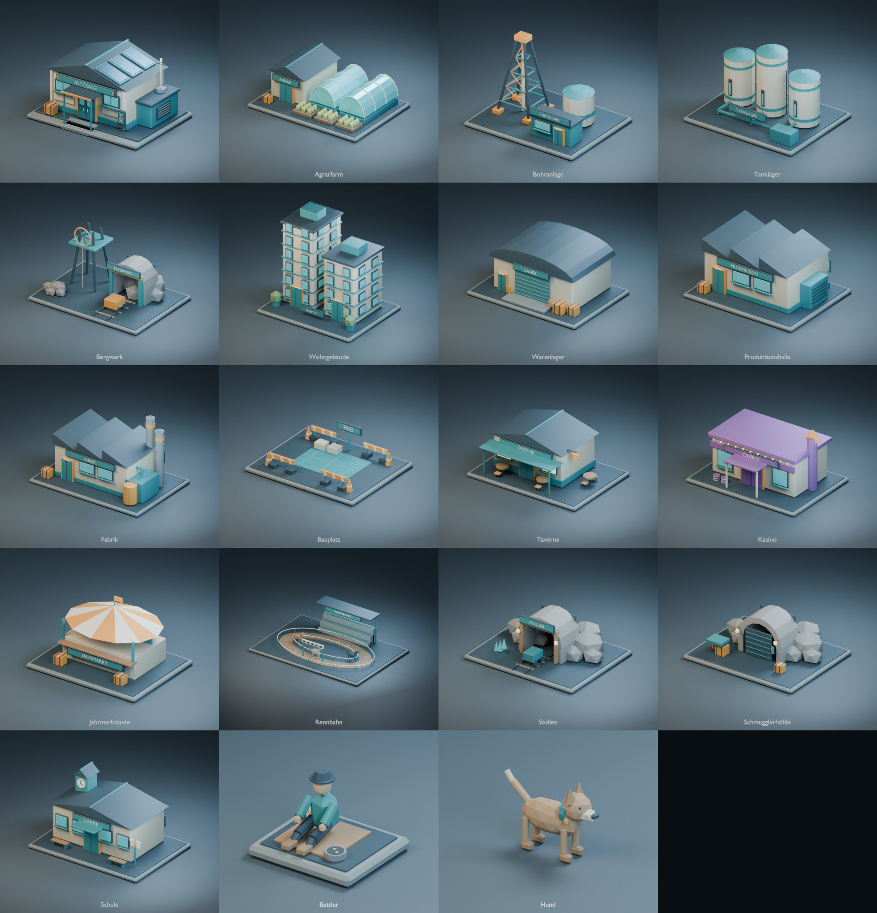

# Planetenoberfläche – Low-Poly-Modelle

19 Modelle im freigegebenen Stil des Questhauses: 17 Gebäude/Anlagen einschließlich Bauplatz, dazu Bettler und Hund.

Jeder Unterordner enthält eine editierbare Blender-Datei, einen GLB-Export, eine gerenderte Vorschau, asset.json, generate.py und eine kurze Beschreibung. Das Questhaus besitzt zusätzlich eine Rückansicht.

## Modelle

| Modell | Datei | Dreiecke | Zuordnung im Spiel |
|---|---|---:|---|
| Questhaus | [questhouse.glb](questhouse/questhouse.glb) | 3616 | kind=questhouse |
| Agrarfarm | [farm.glb](farm/farm.glb) | 3568 | look=farm |
| Bohranlage | [drill.glb](drill/drill.glb) | 2332 | look=drill |
| Tanklager | [silo.glb](silo/silo.glb) | 2028 | look=silo |
| Bergwerk | [mine.glb](mine/mine.glb) | 2040 | look=mine |
| Wohngebäude | [tower.glb](tower/tower.glb) | 8700 | look=tower |
| Warenlager | [store.glb](store/store.glb) | 1906 | look=store |
| Produktionshalle | [hall.glb](hall/hall.glb) | 2000 | look=hall |
| Fabrik | [factory.glb](factory/factory.glb) | 2040 | kind=factory |
| Bauplatz | [plot.glb](plot/plot.glb) | 1656 | kind=plot |
| Taverne | [tavern.glb](tavern/tavern.glb) | 2176 | kind=fun, building=tavern |
| Kasino | [casino.glb](casino/casino.glb) | 2060 | kind=fun, building=casino |
| Jahrmarktbude | [fair.glb](fair/fair.glb) | 1512 | kind=fun, building=fair |
| Rennbahn | [racetrack.glb](racetrack/racetrack.glb) | 5452 | kind=fun, building=racetrack |
| Stollen | [stollen.glb](stollen/stollen.glb) | 1678 | kind=fun, building=mine |
| Schmugglerhöhle | [smuggler.glb](smuggler/smuggler.glb) | 1512 | kind=smuggler |
| Schule | [school.glb](school/school.glb) | 2252 | kind=school |
| Bettler | [beggar.glb](beggar/beggar.glb) | 764 | kind=beggar |
| Hund | [dog.glb](dog/dog.glb) | 680 | kind=dog |

## Verwendung

manifest.json ordnet die Assets den vorhandenen kind-, look- und building-Werten aus client/js/planetside.js zu. Produktionswaren nutzen die sieben vorhandenen Gebäudeformen; Fabrikrezepte teilen sich das Fabrikmodell. Lager nutzen store. Stollen (Unterhaltung building=mine) und produzierendes Bergwerk (look=mine) sind separate Modelle.

GLB: Meter, Y nach oben, Front +Z; Hund blickt +X. Blender: Z nach oben, Gebäude-Front -Y. Der Ursprung liegt auf Bodenhöhe mittig im Grundstück. Grundstücke sind in den Modellen enthalten; die große Studio-Bodenfläche, Kameras, Lichter und Vorschautitel sind ausschließlich in Preview_Stage der Blender-Datei.

Alle Assets sind statisch. Bewegungen wie Förderräder, Rauch, Pferderennen und Schwanzwedeln benötigen bei der späteren Integration eigene Animationen bzw. Effekte. Jedes GLB hat ein Mesh mit mehreren Materialgruppen. Die PBR-Materialien sind eingebettet; keine externen Texturen nötig. Gesamtgröße aller GLBs: ca. 3,45 MB.

Noch nicht in den bestehenden 2D-Canvas-Renderer integriert. Für echtes 3D muss dessen Darstellung separat umgestellt werden.

## Reproduzieren und prüfen

generate_buildings.py enthält Geometrie, gemeinsame Palette, Export und Vorschau-Aufbau der 18 neuen Assets. Die jeweiligen generate.py-Dateien starten nur das gewählte Modell. Vorhandene Modell-Dateien werden nicht überschrieben; für eine neue Variante ROOT auf einen neuen Ordner setzen. Das Questhaus hat seinen eigenen Generator.

validation.json dokumentiert Strukturprüfungen aller GLBs und Blender-Importprüfungen für Farm, Fabrik und Hund (Dreieckszahl und Maße). Alle Vorschauen wurden visuell geprüft.

Alle Modelle und Materialien wurden für dieses Projekt erstellt, ohne Fremdassets.

## Planetenböden

Zusätzlich gibt es [zwölf Bodenmodelle](planets/README.md) mit Straßen, Dekoration und freien Bauflächen. Deren eigener Katalog liegt in planets/manifest.json; die dynamische Platzierung ist in planets/placement.js vorbereitet.
