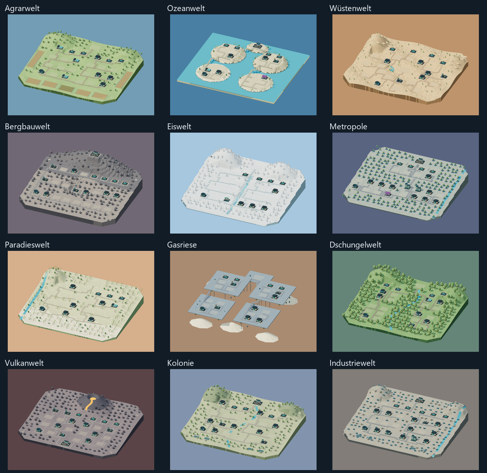

# Planetenlandschaften – Revision 2

Die aktive manifest.json verweist auf die zwölf neuen Modelle unter v2/.
Sie sind im Spiel eingebunden.

 Die erste Revision in den ursprünglichen Typordnern bleibt als Ausgangsversion erhalten.

Jeder neue Typordner enthält ground.glb, ground.blend, layout.json und asset.json.
preview.png zeigt den leeren Boden; preview-populated.png eine Beispielbelegung im Spielrenderer.
Die Gebäude gehören nicht zum Boden-GLB und werden weiterhin dynamisch eingesetzt.

## Landschaften

| Typ | Gestaltung |
| --- | --- |
| Agrar | Bewässerte Feldflächen, sanfte Terrassen und bewaldete Höhen |
| Ozean | Vier unterschiedlich hohe Inseln, eine kleine weitere Insel, Strände und Brücken |
| Wüste | Dünen, eine Oase, Sandsteinberge und Straßen um das Zentrum |
| Bergbau | Abgestufter Steinbruch, mineralische Felsen und ein Bergzug |
| Eis | Gletscherterrassen, Eisfluss, Eisklippen und Schneegipfel |
| Metropole | Drei erhöhte Stadtbezirke, Parks und ein Kanal |
| Paradies | Küstenterrassen, Palmen, Strandflächen und Lagune |
| Gasriese | Schwebende Plattformgruppen auf unterschiedlichen Höhen |
| Dschungel | Waldlichtungen, Fluss und dicht bewachsene Höhen |
| Vulkan | Basaltterrassen, erhöhter Vulkankrater und Lavafluss |
| Kolonie | Pioniersiedlung mit Flusstal, Felsen und Solarfeldern |
| Industrie | Gestufte Betriebshöfe, Halden, Versorgungsanlagen und Kanal |

## Platzierung

Alle Karten haben 24 normale Plätze, einen großen Platz und vier Figuren-/Tierpunkte.
Fabrikkategorien und Kapazitäten entsprechen weiterhin shared/planetside.js.
Die normalen Plätze bieten 13 × 10 m, der große Platz 18 × 13 m und die kleinen Punkte 3,6 × 3,6 m.

Die Anker liegen auf der jeweiligen Gelände- oder Terrassenhöhe, jeweils 0,12 m über dem Boden.
Ihre vollständigen Positionen stehen in layout.json und sind als benannte GLB-Knoten vorhanden.
Die reservierten Grundflächen sind eben und voneinander getrennt; das Gelände dazwischen besitzt Höhenunterschiede.
Die Straßen folgen einer verbundenen Route, die die reservierten Grundflächen umgeht. Auf Insel- und Plattformkarten verbinden erhöhte Brücken die Bezirke.
Alle Gebäude richten ihre Front in +Z aus. glTF verwendet +Y nach oben, Blender +Z.

placement.js exportiert planBuildingPlacements(items, layout, buildingManifest, options).
Die Spielintegration in client/js/planetScene.js übernimmt Position und Rotation vom passenden layout.json.
options.previous bewahrt die Baupunktzuordnung bestehender Gebäude bei Bau und Abriss.
Alle Materialfarben sind eingebettet; externe Texturen sind nicht erforderlich.

## Geführte 2,5D-Ansicht

Die Kamera ist orthografisch mit festem Blickwinkel in der Übersicht.
Anklicken oder die Gebäudeliste startet einen sanften Flug zum Gebäude und richtet die Kamera stärker zur Front aus.
Erneuter Klick, freier Boden, ✕, Esc oder Übersicht führen zurück zur gesamten Karte.
Ziehen verschiebt begrenzt (Übersicht ±24 m, Auswahl ±8 m); Mausrad und Zwei-Finger-Gesten zoomen innerhalb von ±15 %.
Manuelles Drehen ist abgeschaltet. Die Gebäudefunktionen, Bau und Abriss verwenden die bestehenden Panels.

## Erzeugung und Prüfungen

generate_landscapes.py erzeugt die zweite Revision mit Blender-Python.
Ausführen mit Blender im Hintergrund und einer leeren Startszene:
`blender --background --factory-startup --python generate_landscapes.py`

Der Export überprüft die freien Grundflächen, Höhen, GLB-Anker und die Trennung der Baupunkte.
`npm test` prüft Platzierung, Kapazitäten, stabile Zuordnungen und die orthografische Kameraführung.
Die Browserprüfung verwendet eine getrennte Spielinstanz im Arbeitsspeicher und prüft alle zwölf Landschaften, Frontausrichtung, Auswahl, Rückkehr, Bau, Abriss und eingeschränkte Navigation.
