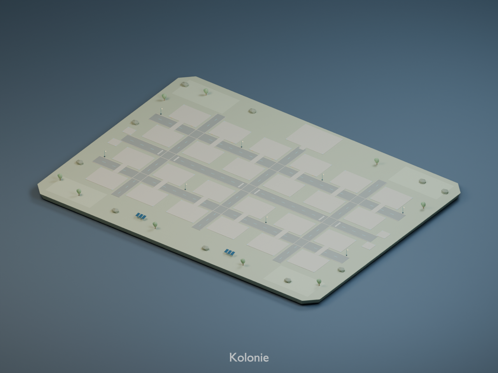

# Kolonie – Bodenmodell

[Dokumentation und dynamische Platzierung](../README.md)

[Beispielbelegung](preview-populated.png)

Drei Geometrie-Meshes, 10300 Dreiecke, 29 Platzierungsanker. Materialien enthalten.

24 normale Plätze (einschließlich Questhaus und Fabrikplätzen), ein großer Rennbahnplatz und vier Figurenpunkte. Fabrikkapazität: bio: 1, chem: 0, heavy: 2, tech: 1.

Gebäude separat laden. In der Blender-Datei sind Beispielgebäude standardmäßig ausgeblendet; die Collection planet_colony__Preview_Buildings lässt sich zur Vorschau einblenden.
