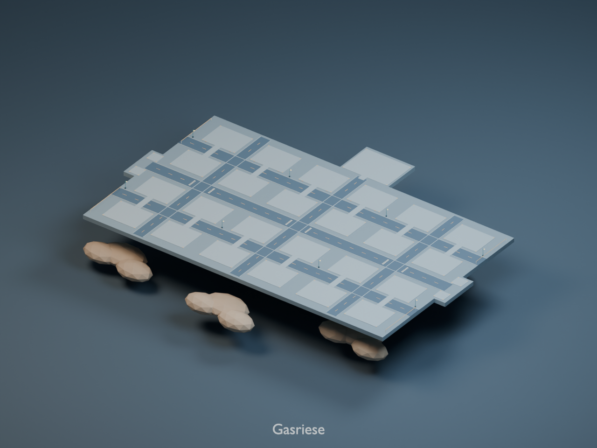

# Gasriese – Bodenmodell

[Dokumentation und dynamische Platzierung](../README.md)

[Beispielbelegung](preview-populated.png)

Drei Geometrie-Meshes, 11128 Dreiecke, 29 Platzierungsanker. Materialien enthalten.

24 normale Plätze (einschließlich Questhaus und Fabrikplätzen), ein großer Rennbahnplatz und vier Figurenpunkte. Fabrikkapazität: bio: 0, chem: 3, heavy: 1, tech: 0.

Gebäude separat laden. In der Blender-Datei sind Beispielgebäude standardmäßig ausgeblendet; die Collection planet_gasgiant__Preview_Buildings lässt sich zur Vorschau einblenden.
